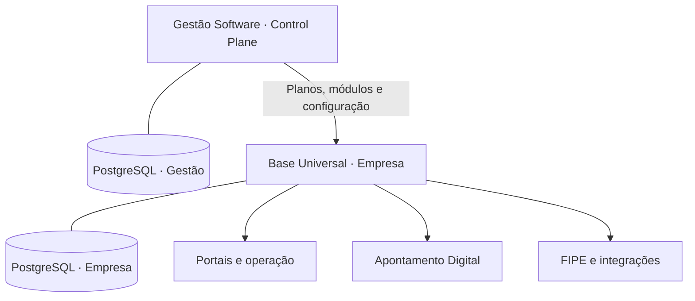

# Gestão Software

**Ecossistema SaaS multiempresa para gestão de operações, provisionamento de aplicações e serviços corporativos modulares.**

> **Software proprietário · Todos os direitos reservados**
> Copyright © 2026 **Carlos Roberto Lima**. O código e os materiais originais deste repositório não estão licenciados para reprodução, modificação, redistribuição ou exploração por terceiros. Leia [Direitos autorais](#direitos-autorais) e [`LICENSE`](LICENSE).

## Visão geral

O **Gestão Software** centraliza o ciclo de vida de empresas-clientes — cadastro, contratos, planos, módulos, identidade visual e infraestrutura — enquanto a **Base Universal** disponibiliza as funcionalidades contratadas em ambientes empresariais. Serviços independentes complementam o ecossistema.

O repositório é organizado como um conjunto de aplicações: **não existe um único executável**. Cada serviço tem responsabilidades, dependências e processos de implantação próprios.

### Capacidades principais

- **Control Plane:** gestão das empresas, ativação e suspensão de módulos, branding, planos, contratos e indicadores comerciais.
- **Cota/Vistoria:** cotação de veículos, vistoria digital, análise, supervisão, documentação e aceite eletrônico.
- **Operação empresarial:** área do associado, eventos, guincho/reboque, oficina e acompanhamento de processos.
- **Apontamento Digital:** presença, jornadas de trabalho, fluxos administrativos e registros de evidência.
- **Financeiro:** mensalidades, indicadores, segunda via de boleto e pontos de integração com provedores externos.
- **Infraestrutura:** provisionamento, gerenciamento de serviços e automação de implantação.

## Arquitetura



**Princípios técnicos:**

1. **Isolamento por empresa:** dados operacionais de cada cliente precisam ser segregados por ambiente e por contexto de autorização. O banco do Control Plane é separado dos bancos da Base.
2. **Separação de responsabilidades:** o Gestão administra o ciclo de vida comercial e técnico; a Base executa as rotinas de negócio da empresa.
3. **Segurança no backend:** identidade, permissões e escopo da empresa devem ser validados em cada operação, independentemente do frontend.
4. **Integrações por adaptadores:** provedores financeiros e serviços auxiliares devem manter fronteiras explícitas, sem acoplamento desnecessário.
5. **Evolução controlada:** migrações versionadas, testes por componente e implantação por ambiente.

## Estrutura do repositório

| Diretório | Responsabilidade | Stack principal |
| --- | --- | --- |
| `gestao-software-v107-central-migracao/backend/` | API do Control Plane | Java 21, Spring Boot, Spring Security, JDBC, Flyway |
| `gestao-software-v107-central-migracao/web/` | Site institucional, painel e contratos | React, TypeScript, Vite, Nginx |
| `nh-base-universal-v122/backend/` | API da Base Universal | Java 21, Spring Boot, PostgreSQL, Flyway |
| `nh-base-universal-v122/web/` | Site e portais da empresa | Web, Nginx |
| `nh-base-universal-v122/nh-ponto/` | Apontamento Digital | Fastify, TypeScript, React, Prisma |
| `nh-base-universal-v122/api-fipe/` | Consulta e atualização FIPE | Python, FastAPI, SQLite |
| `nh-base-universal-v122/face-attendance-api/` | Serviço auxiliar de reconhecimento facial | Python, FastAPI |
| `nh-base-universal-v122/hinova-api/` | Integração legada | Node.js |
| `gestao-cloud-agente-v123/` | Agente de provisionamento e operação | Python, Docker Compose |
| `.github/workflows/` | Integração e validação contínuas | GitHub Actions |

**Persistência:** PostgreSQL nos serviços principais (Neon nos ambientes de demonstração) e armazenamento próprio para a API FIPE. Não se deve presumir compartilhamento de dados entre empresas ou entre bancos de sistemas distintos.

## Desenvolvimento local

### Pré-requisitos

- Java 21 e Maven 3.9+;
- Node.js 20+, pnpm para o Control Plane e npm para o Apontamento Digital;
- Python 3 e PostgreSQL 16+;
- Docker e Docker Compose conforme o serviço.

> **Credenciais:** não há senhas reais neste documento. Configure cada ambiente por variáveis de ambiente e segredos exclusivos. Não publique arquivos `.env`, tokens, dados de associados, chaves privadas ou dumps de produção.

### Control Plane

Os scripts locais preparam um banco isolado, executam verificações e iniciam os serviços. Configure previamente `GESTAO_BOOTSTRAP_CARLOS_PASSWORD` e `GESTAO_BOOTSTRAP_PEDRO_PASSWORD` com valores fortes, fora do repositório.

```bash
cd gestao-software-v107-central-migracao
scripts/setup-dev.sh
scripts/start-dev.sh
```

| Recurso | Endereço local |
| --- | --- |
| Site e painel administrativo | `http://127.0.0.1:3100` |
| API | `http://127.0.0.1:8080` |
| PostgreSQL | `127.0.0.1:55432` |

Para desenvolver a interface React com recarga automática, mantenha o ambiente local ativo e execute em outro terminal:

```bash
cd gestao-software-v107-central-migracao
pnpm --dir web/site-src dev
```

O ambiente preparado pelos scripts usa `.dev/` (ignorado pelo Git), banco dedicado e provisionamento externo desativado. **Nunca o execute contra dados ou credenciais de produção.**

### Base Universal

Configure o PostgreSQL, o segredo de autenticação, a identificação da empresa e as variáveis requeridas pelo ambiente. A pasta `nh-base-universal-v122/` contém arquivos `docker-compose*.yml` e `render*.yaml` para cenários específicos, como demonstração e homologação. Revise o cenário antes de executar.

### Apontamento Digital

```bash
cd nh-base-universal-v122/nh-ponto
npm install
npm run db:generate
npm run db:validate
npm run dev
```

Requer variáveis da API e conexão PostgreSQL válida. O projeto utiliza workspaces separados para API, frontend e gateway opcional.

### API FIPE

```bash
cd nh-base-universal-v122/api-fipe
python -m pytest -q
python -m uvicorn app.main:app --host 127.0.0.1 --port 8000
```

São necessários ambiente Python configurado, base de dados FIPE e variáveis do serviço. Também existe configuração Docker Compose própria.

## Testes e qualidade

Execute as verificações dos componentes afetados antes de integrar alterações:

```bash
# Backend do Control Plane
mvn -B -ntp -f gestao-software-v107-central-migracao/backend/pom.xml verify

# Sintaxe da interface administrativa
node --check gestao-software-v107-central-migracao/web/admin/app.js

# Backend da Base Universal
mvn -B -ntp -Ptenant -f nh-base-universal-v122/backend/pom.xml verify

# Integrações e testes de frontend da Base
python3 nh-base-universal-v122/ci/test_v122_integrations.py
node --test nh-base-universal-v122/web/tests/*.test.cjs
```

O repositório contém pipelines no GitHub Actions. Aprovação automática **não substitui** validação de permissões, migrações, isolamento multiempresa ou testes de homologação.

## Segurança e privacidade

O projeto processa dados pessoais, registros de colaboradores e documentos empresariais. A engenharia deve observar:

- Autenticação, autorização por perfil e segregação multiempresa no servidor;
- Segredos exclusivos por ambiente, sessões controladas e mitigação de tentativas de login;
- HTTPS em ambientes publicados, acesso mínimo a bancos, arquivos e backups;
- Validação de uploads e entradas, trilhas de auditoria e prevenção de vazamento em logs;
- Revisões de dependências, testes de restauração, monitoramento e resposta a incidentes.

As salvaguardas existentes **não equivalem a certificação de segurança ou conformidade legal**. Mantenha controles técnicos e operacionais atualizados em cada implantação.

## Integrações financeiras

O ecossistema possui fluxos financeiros e interface de segunda via de boleto. As configurações `GESTAO_FINANCIAL_PROVIDER` (Control Plane) e `FINANCIAL_PROVIDER` (Base Universal) definem os adaptadores por ambiente. O modo `NONE` **não processa transações reais**.

O fornecedor financeiro definitivo ainda requer definição, credenciais, homologação de webhooks, testes de conciliação e validação de acesso. Segunda via deve ser consultada apenas após autenticação e autorização do associado; não reative rotas legadas de boleto sem autenticação. A contratação do provedor e os testes de integração devem ser homologados antes de operar com cobranças reais.

## Entrega e operação

O projeto contém configurações para Render, Docker Compose e agente de provisionamento. Domínios, recursos contratados e auto-deploy dependem do serviço e do ambiente configurado.

Antes de cada publicação:

1. Confirme as configurações e segredos, sem registrá-los no repositório.
2. Verifique banco, migrações e recuperação de backups.
3. Valide autenticação, autorizações e isolamento entre empresas.
4. Execute testes, smoke tests, checagens de saúde e observabilidade.
5. Revise HTTPS, limites operacionais e plano de reversão.
6. Homologue integrações externas antes de operar com cobranças reais.

O êxito do build ou de um deploy automático não comprova, isoladamente, a saúde funcional do sistema.

## Padrões de manutenção

O desenvolvimento é **restrito aos profissionais autorizados** pelo titular. Para alterações internas: utilize branches específicas, commits rastreáveis, testes proporcionais ao risco, migrações compatíveis e revisão antes de integrar à branch principal. Preserve históricos, contratos assinados e evidências de auditoria. Não adicione dados ou senhas de clientes ao código nem à documentação.

## Direitos autorais

**Copyright © 2026 Carlos Roberto Lima. Todos os direitos reservados.**

O código-fonte, a documentação, as interfaces e os demais materiais **originais** deste projeto são proprietários e **não possuem licença de código aberto**. A publicação do repositório não concede permissão para copiar, adaptar, modificar, redistribuir, sublicenciar, comercializar, hospedar como serviço ou desenvolver produtos derivados sem **autorização prévia e por escrito de Carlos Roberto Lima**, ressalvados os direitos assegurados pela legislação aplicável e pelas condições obrigatórias da plataforma de hospedagem.

Dependências e componentes de terceiros conservam suas próprias licenças. As condições completas de reserva de direitos estão em [`LICENSE`](LICENSE).

**Responsável:** Carlos Roberto Lima · [GitHub](https://github.com/developercarloslima)
